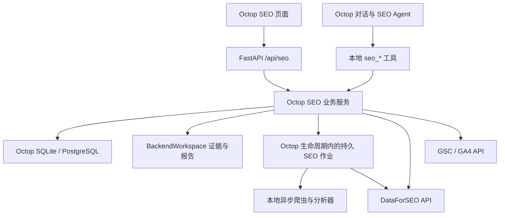

# OpenSEO 功能复刻与 Octop 原生实现方案

> 当前实现与验收边界见 [SEO 能力矩阵](seo-current-capabilities.md)。本文中的日期、未实施项和发布状态属于历史记录。

> 2026-10-14 实施更新：首个关键词流程已在Octop原生实现。当前接口、实际边界、有意差异和验收结果以 [keyword-workflow-spec.md](seo-replica/keyword-workflow-spec.md) 为准。本文后续完整平台设计仍是路线图，不表示已交付。首版只含国家Labs研究、选词与标签、私有报告和Octop对话；不包含Google授权、审计、排名、通用任务系统。报告采用有字节上限的数据库正文与不可变版本，替代此前首版工作区文件建议。实际付费与真实模型验证尚未执行。


日期：2026-10-14。版本：v2，按用户最新澄清重写。状态：R1 已上线（2026-10-16）；R2 技术审计已在分支 `seo-workbench-native` 实现，尚未上线，Google 搜索表现待做；实现记录见 `seo-replica/keyword-workflow-spec.md`。

**目标是以 OpenSEO 为参考产品，通过 REA 还原页面、交互与业务规则，将自己的 SEO 工作台直接实现到 Octop 的前后端和数据库中。** OpenSEO 源码用于研究、移植和行为对照，最终产品由 Octop 独立运行。

本文替代上一版“独立运行 OpenSEO、通过 MCP 接入 Octop”的方案。上一版的上游项目映射、OpenSEO 服务连接和双系统数据权威均已退出目标架构。Octop 的 SEO 服务直接调用所需的数据供应商和 Google API，不依赖 OpenSEO 的账号、页面、后端或 MCP。

## 1. 复刻范围及验收口径

复刻对象有三个层次：

1. **产品行为**：项目切换、关键词搜索、多搜索标签、筛选排序、保存、审计进度、报告阅读等可观察行为。
2. **业务语义**：数据来源、指标含义、去重、市场/设备维度、空值、缓存、费用、部分失败和异步任务生命周期。
3. **可移植实现**：纯 TypeScript 逻辑、常量与 schema、报告模板、技能流程、测试样本，以及可翻译为 Python 的服务逻辑。

最终用户看到的是 Octop 内的 SEO 工作台：页面结构、字段和核心交互参考 OpenSEO；登录、外壳、语言、主题、Agent 和聊天使用 Octop。首版以功能与行为一致为目标；不默认承诺全站逐像素复制。

数据源默认沿用原产品所使用的 DataForSEO、GSC 和 GA4。自主实现的是产品和业务服务，不包括重新建立全球关键词、外链或搜索引擎索引。供应商采购和 Google 授权仍需要单独配置。

最终产品覆盖项目、关键词、已保存关键词、域名/竞品、外链、搜索表现、审计、排名、AI 可见性、提示词探索、背景与报告。分期交付不改变这个总体方向。

先复刻三个可验证闭环：关键词研究与保存、GSC/GA4 搜索机会诊断、基础站点审计；同时加入任务、对话和正式报告。后续补竞品/外链、排名跟踪、AI 功能及更完整视图。OpenSEO 的商业订阅、营销站、品牌素材和 SAM 运行时不作为功能复刻目标。

## 2. 当前证据和 REA 的职责

### 2.1 已有证据

| 对象 | 已检查范围 | 限制 |
| --- | --- | --- |
| Octop | 本地 `/Users/wzb/Code/Octop`，`workbench-plugin-pages` 分支，提交 `5acbaf4c9ddc7fc34de07e4583b9afd290d97db9` | 未启动应用做本轮运行验证 |
| OpenSEO | `every-app/open-seo`，提交 `d7ea7852480601af9bc8870942af8311a410e567` | 不能推定等于线上部署提交 |
| REA 网站采集 | 首页、价格计算器交互、公开报告外壳，12 份脚本响应导出与静态分析 | 未覆盖登录后的完整业务界面；部分网络响应未完成 |
| REA 仓库扫描 | 1,373 个 JS/TS 文件；后续查看关键词服务、关键词页面、共享词量分组和页面分析器 | 全仓语义图受内存限制，覆盖 partial；具体文件的静态事实可单独核验 |
| REA Octop 模块 | 工作台插件页面模块6个文件，0解析失败，应用结构覆盖 complete | 静态结构不是产品端到端验收 |

**上轮的首页与价格页采集不能代替 OpenSEO 应用的完整逆向。** 登录后的关键交互要在授权测试环境中补录；源码用于解释行为与填补实现细节，不能把推断标为线上实测。

### 2.2 逐功能逆向流程

每个功能建立一张可复刻契约卡，字段至少包括：

- 原页面和本地目标页、输入参数、输出字段、指标单位。
- initial/loading/empty/success/partial/error 等状态及可用动作。
- 搜索、筛选、分页、保存和刷新如何改变页面与网络请求。
- 调用端点、参数默认值、缓存键、费用、异步任务 ID。
- 原源码位置、固定 commit、REA Evidence ID、截图/DOM/脱敏响应。
- 事实属于现场观察、源码确认还是推断；未覆盖行为明确留空。
- 原行为、我们选择保留或调整的行为，以及比较方式。

REA 的工作流程：

1. 用 `capture_browser_scenario` 在隔离测试会话记录明确动作及前后状态；已有授权浏览器可用被动 `inspect_web_page`。
2. 导出实际保留的脚本，用 `analyze_javascript_application` 分析；大项目先 summary，再用 `inspect_analysis_view` 查看具体文件或节点。
3. 有明确种子后才用 `trace_application_feature` 追踪相关静态关系，记录缺失边和推断，避免把静态可达当作实际执行。
4. 对源码中的纯计算和结果解析建立离线固定样本，记录参考输出；对异步动作记录完整状态序列。
5. 在 Octop 中实现后，用同样输入和交互脚本验证字段、状态、费用边界和产物，而不是只比较页面看起来像不像。

抓取登录页面需要已授权测试账号或测试实例；涉及收费的动作需要明确测试额度。没有这些条件时仍可完成源码契约和离线样本，但该功能的现场行为栏保持“待验”。不会在本轮方案编写时注册账号或发起收费查询。

## 3. 复用分类

“复用”在本版指代码/规则/测试资产的复用与移植，不再指调用 OpenSEO 服务。

| 分类 | 适用内容 | 处理方式 |
| --- | --- | --- |
| 可直接保留的资产 | SEO 技能步骤、报告模板结构、静态选项、问题分类文案、脱敏测试样本 | 固定来源版本，保留适用许可证，改项目命名与工具契约 |
| 可移植的纯前端 TS | 关键词显示分组、过滤/导出、格式化、状态数据类型 | 检查导入和副作用，移入本地 feature，运行原有/等价测试 |
| 需适配的 React 组件 | 表格、筛选面板、图表、详情布局 | 对齐 Octop React 18、Ant Design/现有控件、i18n、React Router；拆除 TanStack Start server-function 依赖 |
| 需移植到 Python 的业务代码 | DataForSEO 响应解释、关键词研究组合/回退、域名和外链聚合、审计规则、Google 数据处理 | 保留行为契约与样本，重写 FastAPI/infra 服务，不从浏览器调用供应商 |
| 需替换的运行设施 | Drizzle/D1、KV、R2 访问、Cloudflare Workflows/DO、Hyperdrive | 使用 Octop DB、BackendWorkspace、生命周期管理和持久任务记录 |
| 直接用 Octop 的能力 | 用户/JWT、Agent、模型配置、thread、trajectory、HITL、工作区、cron | 加 SEO 领域归属和回执，不重建第二套对话系统 |
| 不迁入的部分 | SAM、Autumn 订阅/28%加价、OpenSEO 托管账号、营销站 | Octop 复用自己的运行能力，供应商费用按实际成本记录 |

已验证的例子：

- `groupSharedVolumeRows.ts` 只导入关键词类型，适合保留 TypeScript 实现及测试；它识别共享搜索量的近似词组，不能将同一组词量简单相加。[S2]
- `KeywordResearchPage.tsx` 引用搜索标签、URL 状态、控制器及自有 UI；要按功能拆分移植，不是一个可直接塞入 Octop 的独立页面。[S1]
- `page-analyzer.ts` 的规则主要围绕 HTML token、链接和元数据，但使用 `htmlparser2`；Python 版本需要明确解析器差异，并用相同 HTML 样本对照。[S3]
- DataForSEO core 同时检查 HTTP 与 task-level 错误、区分可重试读取和可能已收费的超时；这些语义需要保留。[S4]

OpenSEO 使用 MIT 许可证。实际复制代码、文案或样本时在相应目录保留来源与版权声明，并记录第三方依赖；产品采用自己的名称与素材。此处不将所有原项目资源一概视为 MIT 自有素材。

## 4. 功能复刻矩阵

| 功能 | 应保留的体验/语义 | Octop 实现 | 阶段 |
| --- | --- | --- | --- |
| 项目与背景 | 域名、市场、业务目标、竞品、关键页、研究日志 | 本地 SEO project/context 数据，专用 Agent 绑定 | R1 |
| 关键词研究 | seed、国家/语言、数量、模式、共享词量、结果表、多搜索标签 | Python 研究服务 + 原生页面；纯 TS 分组/导出可移植 | R1 |
| 已保存关键词 | 批量保存、标签、筛选、市场归属、指标更新时间 | 本地 keyword/tag/metric 数据与批量接口 | R1 |
| SERP 分析 | organicRank 与所有结果 rank 的区别、设备/地区、结果深度 | DataForSEO 直接适配器；缓存和费用归属 | R1 |
| 搜索表现与机会 | GSC 表现、GA4 着陆页/转化、日期窗口和 property 归属 | 新 Google 授权与本地查询/聚合 | R2 |
| 技术审计 | 启动→抓取→分析→问题与URL，部分抓取失败 | Python 爬虫、分析规则、持久进度 | R2 |
| 对话、任务、报告 | 数据驱动讨论、可读报告、来源与版本 | Octop Agent/线程 + SEO 任务与报告版本 | R1–R2 |
| 域名与竞品 | 估算流量、排名词、页面、竞品维度 | 直连供应商，移植规范化和过滤逻辑 | R3 |
| 外链 | 总览、来源域、链接、目标页与历史 | 本地查询/缓存/展示，保留来源与时间 | R3 |
| 排名跟踪 | 配置、调度、历史、桌面/移动、未命中与失败区分 | Octop 调度 + 供应商 task_post/get + 本地历史 | R3 |
| AI 可见性与 Prompt Explorer | 问题、模型、回答、引用、品牌/竞品、趋势 | 供应商适配器、自己的持久采集和结果模型 | R4 |
| 进阶渲染/Lighthouse/Local SEO | 明确成本与覆盖范围 | 在基础闭环稳定后单独移植 | 后续选择 |

“未命中”不等于排名为0，“无数据”不等于流量为0，估算流量不等于 GSC 点击。指标说明、数据时间和限制属于复刻的一部分。

## 5. Octop 原生架构



最终运行链路中没有 OpenSEO 服务节点。我们的源码、数据库、API、任务和页面都在 Octop；外部边界仅保留确实需要的数据/模型供应商和 Google 账户。

### 5.1 前端落点

采用原生 dashboard feature：`dashboard/src/features/seo/`。用当前工作台注册接口把 `SeoWorkbenchPage` 注册为 `/workbench/seo-workbench.main`，组件随 Octop dashboard 构建；第一版不必另发独立插件 ZIP。

这利用已有工作台扩展点，也便于正常导入 Octop UI、路由和聊天相关能力。上版独立插件 ESM 的打包限制不应再成为原生 feature 的默认负担。若以后需要可独立安装插件，再单独抽包。

页面结构建议：站点切换 + 内部导航（总览、关键词、搜索表现、审计、任务、报告、设置），后续增加竞品、外链、排名、AI。根路由不先扩展成新的全局应用；项目和视图写入 URL 的 query 或明确子路由，后端始终核对项目权限。

首版点击任务进入 Octop 已有 `/chat/{agentId}/{threadId}`。如果要求聊天常驻 SEO 页面，需要抽取可控的会话视图；这部分属于额外 UI 组合，不能把现有巨型 Chat 页面当作已经可嵌入的组件。

### 5.2 后端落点

以下为拟新增目录，随阶段实际使用再建立：

```text
src/octop/api/routers/seo.py
src/octop/infra/seo/
  projects.py             项目、背景和用户/Agent归属
  keywords.py             研究、指标、保存与缓存
  search_performance.py   GSC/GA4 聚合与机会分析
  domain.py               域名、竞品
  backlinks.py            外链
  rank_tracking.py        排名配置与结果
  ai_visibility.py        AI采集与引用
  reports.py              报告版本、审核与读取
  tools.py                一方 Agent 工具
  providers/
    dataforseo.py         认证、任务信封、错误、原始成本
    google.py             OAuth、刷新、API调用
  audit/
    fetcher.py            限流、安全抓取、robots、重定向
    analyzer.py           页面分析
    rules.py              页内/跨页问题规则
  jobs/
    runner.py             单进程有界执行、重启恢复
    audit.py              抓取和分析步骤
    rank.py               提交与取回供应商任务
    ai.py                 后续AI采集
src/octop/infra/db/repos/seo_*.py
```

HTTP 路由只做校验与错误转换；业务留在 `infra/seo`；SQL 留在 repo，通过现有 SharedServices/RepoBundle 注入。前端 API 和 Agent 工具调用同一业务服务，避免两套判断逐渐分叉。

Agent 工具采用既有 `build_cronjob_tools` / `build_knowledge_tools` 的一方服务注入模式，构造 `build_seo_tools(services, bound_agent_id)`。不为此重建通用插件 DI，不要求再启动一个本地 MCP 服务。以后要对其他 Agent 开放自己的 SEO 能力，可以复用 Octop 的接口另行暴露 MCP。[O1]

## 6. 数据模型从映射升级为自有数据

上一版四张映射/任务/报告表不足以支撑原生复刻。现在 SEO 项目、关键词、审计和历史数据都由 Octop 持有，不存在 `upstream_project_id` 作为业务权威。

按功能阶段增加表族，避免一次性复制 OpenSEO 全部 schema：

| 表族 | 核心内容 | 时机 |
| --- | --- | --- |
| 项目与背景 | `seo_projects`、context sections、competitors、key pages、research log | R1 |
| 关键词 | saved keywords、tags、关联表、指标快照/研究结果 | R1 |
| 缓存与供应商回执 | 请求 fingerprint、来源、fetch时间、过期时间、成本、原始结果引用 | R1 |
| 业务执行 | tasks、runs、逐供应商 calls；thread/turn、输入快照、状态、错误 | R1 |
| 报告版本 | logical report、不可变 version、hash、审核与来源 run | R1–R2 |
| Google 授权绑定 | 私有凭证引用、project/property关联、scope、授权状态 | R2 |
| 审计 | audit runs、frontier/page状态、页面字段、链接、问题与受影响URL | R2 |
| 排名 | tracker、keywords/devices、runs、provider task、历史结果 | R3 |
| AI | trackers、prompts、models、runs、answers、mentions/citations | R4 |

遵循 Octop 现有公开字符串 ID、用户归属、SQLite/Postgres 双 migration 规则；不直接导入 Drizzle 生成的 DDL，也不预设 migration 编号。[O2]

最少必须保存的公共语义：`project_id`、来源 provider、国家/语言/设备、数据日期、查询时间、输入参数哈希、结果完整性、费用来源。不同市场、日期窗口或设备不能复用错误的缓存。

数据库保存可查询字段及状态；较大的原始响应、截图、HTML、CSV 通过 BackendWorkspace 保存引用，记录大小和哈希。文件/数据保留期在实现时按实际量制定，不把所有返回内容无期限塞进聊天。

任务/run记录需要显式的launch幂等键和“一任务一个活跃run”约束；供应商调用记录关联具体run及上游task ID。同一tracker或audit配置也需要active-run约束，调度以数据库原子领取时间槽。单进程首版就要防止手动、Agent和cron并发重复提交，不能只依赖页面按钮或内存锁。

项目背景、任务和报告的权威均在 Octop。供应商是外部事实来源，不能因远端 API 错误回写覆盖已审核的历史结果。

## 7. 以关键词研究为首个完整复刻样板

此功能同时覆盖页面、业务规则、供应商成本、缓存、项目隔离和报告，最适合先做。

1. **输入还原**：关键词、国家/语言、可选地区、150/300/500结果上限、auto/related/suggestions/ideas、clickstream、共享词量选项。先冻结已核验的组合，未实现组合在UI明确禁用。
2. **行为还原**：多搜索标签保存各自输入；标签、URL和项目状态一致后才触发查询，切换标签不误买另一个市场的数据。
3. **供应商调用**：移植 `research/research.ts`、`research-data.ts`、`selection.ts` 的选择、混合和回退逻辑；每次实际请求独立落账。Google Ads 来源的缺失 KD/intent 保持 null/unknown。
4. **展示语义**：关键词归一化和去重；量、CPC、趋势、难度、意图按原样本解释；共享词量分组是显示关系，不把一组词量当作多个独立需求累加。
5. **保存与读取**：按项目和市场保存关键词及标签，读回校验；每份指标有来源与日期。
6. **交付**：首个切片的收费研究由页面明确触发；Octop Agent 使用 `seo_get_report_context`、`seo_list_saved_keywords` 和 `seo_save_report`，形成建议后保存正式报告版本。将来若开放付费研究工具，需单独实现可信费用授权，不能只依赖模型传入confirm_paid。

可保留纯 TS 的分组/导出逻辑；Python 服务用同一固定样本验证混合、回退、空值和失败行为。为正确性保留必要差异：原参考实现若有缺陷，应记录“有意修正”，不能为像原版而复制缺陷。

参考实现：[关键词服务入口](https://github.com/every-app/open-seo/blob/d7ea7852480601af9bc8870942af8311a410e567/src/server/features/keywords/services/KeywordResearchService.ts)、[研究实现](https://github.com/every-app/open-seo/blob/d7ea7852480601af9bc8870942af8311a410e567/src/server/features/keywords/services/research/research.ts)、[页面](https://github.com/every-app/open-seo/blob/d7ea7852480601af9bc8870942af8311a410e567/src/client/features/keywords/page/KeywordResearchPage.tsx)。

## 8. 需要重新实现的关键基础能力

### 8.1 Google 授权

GSC/GA4 直接连接我们的 Octop。新增 Google OAuth start/callback、短期 state、用户/项目绑定、只读 scope、加密 refresh token、刷新锁与重新授权入口。复用 Octop 的加密和身份能力，但不能把已有 MCP OAuth 当作已经完成 Google 资源授权。

授权完成后明确选择 Search Console property / GA4 property，并校验当前项目可用范围；列表显示“已连接”只代表配置状态，至少还需一次指定站点查询和刷新验证。[D1][D2]

机会分析保留两种数据的来源时区、日期窗口、页面归一化规则、未匹配行和覆盖限制。内部调度时间保存UTC，用户展示遵循Octop服务器配置的时区；转换不能改变Google原始统计日期的含义。

联合算法建立固定fixture：GSC final页面行、GA4 organic landing rows、候选平均排名4–20、URL join规则、仅matched行评分、unmatched行score=null、整个matched cohort无keyEvents时才使用engagementRate，以及1,000行截断和coverage。该评分是当前结果集的排序启发式，不是全站绝对价值或保证收益。以上是固定源码版本的参考契约，调整时需明确记录有意差异。

### 8.2 数据供应商与成本

在 Octop 内实现 DataForSEO HTTP 适配器，保留 HTTP 错误与 task-level 错误区分。API可能返回HTTP200但具体任务失败，不能据此标记成功。

记录供应商原始美元费用，不复制 OpenSEO 托管版的 1.28 加价和 Autumn credits。模型费用沿用 Octop 使用量记录，分别展示。不同价格表、回退调用、clickstream 和结果深度会影响成本，因此价格不能只写死成“每次搜索固定多少钱”。

不要照搬其自托管客户端对billing元数据的裁剪。我们保留统一回执：endpoint、provider_task_ids、raw_cost_usd、request_hash、project_id、run_id、cached、status、observed_at；缺少原始费用则明确unknown。`shared/rank-tracking.ts` 等看似纯工具文件也引用托管加价计算，移植前必须拆出原始成本语义。

调用前写入持久请求记录并原子预留预算；响应后核销，缺少费用时标为 estimated/unknown。超时可能已经付费，不盲目重试。对供应商异步任务保存其 task ID，恢复时先取回；本地幂等键不代表供应商 exactly-once。DataForSEO 文档说明 SERP task_post 的收费点在创建任务，故不能把轮询失败当作重新提交的理由。[D3]

### 8.3 爬虫与安全抓取

基础审计原生迁入 Python：站点范围、robots、sitemap/链接发现、重定向、并发限制、页面大小、超时、HTML提取、页内规则和跨页规则。

OpenSEO 依赖 Workers 的部分出站保护不能随源码自动带入 FastAPI。需要在自己的抓取器验证目标地址、重定向后的目标、实际连接地址和私网/元数据地址阻断；DNS验证失败不能当作通过。只校验用户输入域名后交给普通 fetch 不足以覆盖重定向/DNS变化。此项是迁移验收内容。

首版限定50页、非JS渲染，以固定HTML样本验证 title/description/headings/canonical/robots/links/alt/结构化数据。使用现有浏览器底层能力做渲染属于后续增强，需独立的资源限额与出站控制；不将原产品“可选Lighthouse”误当成本地爬虫已有能力。

### 8.4 持久作业取代 Cloudflare Workflows/DO

在 Octop 生命周期内增加单进程、有界并发的 SEO job runner，作业状态与进度持久化到数据库。复用 cron 作为触发来源，不能只在请求处理函数中创建临时 asyncio task 后就宣布有恢复能力。

审计保存 frontier/已处理页面；排名和AI采集保存 provider task ID。启动时扫描上次未终止作业，能对账的继续取结果，不能确定收费结果的转 unknown_outcome。取消停止新操作，已提交的外部任务可能仍会收费/完成。

所有调度权威在 Octop，不再有 OpenSEO/Octop 双调度的问题。首版单进程，不先增加 Redis/Celery 或单独微服务；数据库原子claim、active-run唯一约束和持久step/provider-task去重在首版实现。后续多实例的租约、过期判定和fencing另行设计。现有 cron 的成功状态不能代替真实SEO回执。

## 9. Octop 原有能力怎样保留

- **Agent与对话**：MVP一站点一个非共享Agent及工作区，多个任务线程；沿用模型提供商和聊天执行。
- **执行身份**：在一方工具闭包中绑定Agent，从运行上下文与DB核对 user→project→task→thread→run；每次调用都校验，包括HITL resume。未绑定子代理/peer上下文拒绝执行。
- **权限**：工作台入口可见不等于项目数据可读；API、工具、导出和报告读取均校验所有权。UI的activeAgent、模型参数不决定权限。
- **供应商凭证**：复用加密储存，新增SEO私有provider用途；不使用会回传header/env的普通custom-MCP配置承载必须对前端隐藏的秘密；不向Agent工作区或任意网络工具暴露密钥。[O3]
- **技能**：移植OpenSEO的研究方法和证据要求，工具改为本地`seo_*`；步骤和输出随来源版本管理。
- **报告**：先创建staging版本记录，经BackendWorkspace写入新路径、读回hash后转ready；审核绑定具体版本。正式版本写保护覆盖普通编辑、上传和Agent工具；读取时校验完整性。
- **预览**：SEO报告使用禁止脚本/表单的静态沙箱。现有通用HTML预览允许脚本，需为SEO提供受控模式。
- **审批**：交互HITL仍复用；长期预算授权、报告审核和运行状态持久化。进程内pending registry不能代替这些记录。
- **运行可见性**：复用默认trajectory的thread/turn关联，不依赖默认关闭且SQLite-only的history_v2。

本地SEO工具与HTTP接口必须调用同一份服务。一个用户在页面点击“研究关键词”和Agent执行该动作，应得到一致的权限、缓存和计费行为。

## 10. 拟新增接口与目录安排

接口按功能逐步增加，不一次性复制76个MCP工具。下面是本地业务接口草案：

| 接口族 | 作用 |
| --- | --- |
| `/api/seo/projects`、`/{id}/context` | 本地项目、市场和背景 |
| `/api/seo/projects/{id}/keyword-research` | 显式发起研究，返回run/result引用 |
| `/api/seo/projects/{id}/keywords` | 保存、标签、过滤、指标日期 |
| `/api/seo/projects/{id}/search-performance` | GSC/GA4读数与时间窗口 |
| `/api/seo/projects/{id}/audits` | 创建和读取审计 |
| `/api/seo/tasks`、`/runs/{id}` | 业务任务、执行、状态、取消和恢复 |
| `/api/seo/reports/{id}/versions` | 版本保存、读取和审核 |
| `/api/seo/providers/*` | 脱敏状态、设置/授权及连通性检查 |

Google callback、报告文件输出等具体路由在实现时补齐。读取页面/结果与发起新的收费查询是不同操作；GET展示不因刷新页面自动产生供应商支出。

前端建议：

```text
dashboard/src/features/seo/
  SeoWorkbenchPage.tsx
  projects/  keywords/  saved/  search-performance/
  audit/  tasks/  reports/  settings/
  domain/  backlinks/  rank-tracking/  ai-visibility/  # 后续阶段
  shared/       本地数据类型、必要的纯TS逻辑
dashboard/src/api/modules/seo.ts
```

注册工作台页面只需一个小的宿主改动；新feature使用既有React与UI体系。未使用的后续目录不先搭空架子。

源码/规则来源记录可放 `docs/seo-replica/source-map.md`，固定样本在 `tests/fixtures/seo/`，前端交互测试随feature放置。这些是后续实施交付，不表示本轮已经创建。

## 11. 复刻验收方法

采用“同输入、同样本、同状态”的对照，不以不同时间的实时SERP数值完全相等作为正确性标准。

| 层级 | 方法 | 通过条件 |
| --- | --- | --- |
| 规则 | 原测试样本/脱敏供应商响应作为golden fixtures | 归一化、去重、空值、排名、错误、成本解析与参考契约一致 |
| 语言移植 | 相同JSON/HTML输入分别经过参考TS与Python实现 | 指定字段相同；差异有清单和明确理由；fixture来源不伪装成生产数据 |
| 页面 | REA动作、DOM/截图和我们UI的对应动作 | 表格字段、筛选、分页、标签恢复、保存/导出、错误态符合契约 |
| 运行 | 真供应商的最小预算测试、Google测试property | 有请求ID/数据时间/费用回执与本地持久记录 |
| 异步 | 模拟中途重启、轮询失败、重复点击和取消 | 不重复创建收费任务；能恢复或明确unknown/interrupted |
| 权限 | 第二用户、错误站点、篡改Agent/thread/run、子代理、resume | 在执行层拒绝；数据和凭证不串用 |
| 报告 | 新旧版本、staging失败、覆盖尝试、读取hash失配 | ready版本可追溯；未完整保存不能算成功；审核不跨版本 |

原项目测试存在不等于我们已通过测试。移植时需要实际执行离线参考样本和本地测试，再做受控真实调用。

关键不变量：

1. 搜索标签切换不能用陈旧市场参数触发付费查询。
2. 同词不同国家/语言/设备/时间窗口的数据保持区分。
3. 部分供应商任务失败不被包装为整体成功，费用未知不记0。
4. 排名未进入抓取范围不伪装为不存在，organicRank不与混合SERP序号混用。
5. Google数据的日期、维度、过滤和property清晰；GSC点击与GA4会话/转化不强行相等。
6. 审计受页数、robots或抓取失败限制时，报告不宣称全站无问题。
7. Cron完成必须对应真实数据/报告，不以“Agent生成了文字”为成功。
8. 禁止普通入口绕过provider预算和项目归属；预算由服务端执行。
9. 打开页面、切站点、读历史数据不会无提示重新购买数据。
10. 关闭OpenSEO服务仍能在Octop完成所有已验收工作流，这是本版的独立运行验收。
11. AI结果明确标记消费端抓取、搜索AI摘要或模型API响应，以及引擎/模型/地区/时间；不能把一次普通模型API回答当作品牌在消费端搜索中的真实可见性。

## 12. 分阶段交付与工程量

本版重新估算：原生复刻包含数据服务、授权、数据库和作业运行，上一版8–13天的MCP接入MVP估算不再适用。

| 阶段 | 交付 | 验收门槛 | 单人预计工程量 |
| --- | --- | --- | --- |
| R0 逆向契约 | 功能/页面状态清单、REA证据、源文件映射、固定输入输出、待验行为 | 首批三条流程的字段和状态契约可执行；无法现场观察的项明确标记 | 2–4天 |
| R1 原生骨架与关键词 | Octop项目/背景、工作台、provider适配器、缓存/调用账本、关键词/SERP/保存、本地Agent工具 | 无OpenSEO服务依赖完成关键词闭环；费用和站点隔离通过 | 6–9天 |
| R2 Google与审计闭环 | 原生Google OAuth/GSC/GA4、50页爬虫/规则、持久run、报告版本与审核 | 搜索机会和审计真实完成；报告与费用读回；基本重启恢复通过 | 8–12天 |
| R3 竞品外链和排名 | 域名/外链视图、tracker、历史、原生调度与供应商异步任务 | 一次真实排名调度回执，重复/丢响应不重复购买 | 6–9天 |
| R4 AI能力 | Prompt Explorer、品牌/竞品提及、引用和趋势、调度 | 回答/引用/模型/日期可追踪；有限预算真实样本通过 | 5–8天 |
| R5 稳定性与收尾 | 跨数据库、备份恢复、批量性能、长任务、UI状态、来源清单 | 回归与恢复演练通过，已选功能验收矩阵闭合 | 3–5天 |

三个核心闭环的原生MVP约 **16–25工程日**；完成上述主要功能面约 **30–47工程日**，按单人约6–10周。区间基于代码审查，包含功能移植与正常验证，不含等待账号/授权、外部服务故障或额外逐像素要求。R0完成后按实际契约与差异缩小估算。

不能用代码复制比例推算这些工期：纯规则迁移较快，授权、异步恢复、数据正确性和费用对账通常决定可用性。

## 13. 第一轮具体开发任务

| 编号 | 责任范围 | 输出 |
| --- | --- | --- |
| REPL-01 | REA与契约 | 首批功能卡、证据索引、golden fixtures，明确未观察状态 |
| REPL-02 | 本地项目与权限 | 项目/背景/Agent绑定和双数据库迁移 |
| REPL-03 | 原生provider | DataForSEO HTTP/task信封、私有凭证、成本与未知结果 |
| REPL-04 | 关键词业务 | 来源组合/回退、去重、指标、缓存、保存/标签 |
| REPL-05 | 原生UI | 工作台注册、关键词页、多标签、筛选分页、状态和保存 |
| REPL-06 | 本地Agent工具 | 可信user/thread/run、技能适配、页面与工具共用服务 |
| REPL-07 | Google | 原生OAuth、property绑定、GSC/GA4与机会诊断 |
| REPL-08 | 审计 | 安全抓取、页面分析/问题规则、持久进度和恢复 |
| REPL-09 | 任务报告 | 业务状态、回执、不可变版本、审核和静态预览 |

顺序：REPL-01 → 02/03 → 04/05/06 → 07/08/09。后续阶段按完整复刻矩阵继续扩展。所有代码落在Octop的业务remote/fork；当前 `origin` 指向上游TencentCloud，提交时需明确目标。研发保留既有 `.claude/` 与当前分支改动。

本轮只改写方案，没有实现上述模块、启动付费采集或部署。实施完成仍按Octop规范运行相关测试、`make all`、前端类型检查及构建；当前不会为文档改动运行会格式化源码的流程。

## 14. 证据与来源

- [O1] [Octop一方工具注入](/Users/wzb/Code/Octop/src/octop/infra/agents/manager.py:3119)、[工作台页面](/Users/wzb/Code/Octop/dashboard/src/pages/Control/Workbench/index.tsx:42)、[工作台注册](/Users/wzb/Code/Octop/dashboard/src/plugins/workbenchPages/registry.ts:42)。
- [O2] [Octop数据与文件约定](/Users/wzb/Code/Octop/AGENTS.md:205)、[SharedServices](/Users/wzb/Code/Octop/src/octop/infra/db/services.py:37)。
- [O3] [凭证加密/刷新实现](/Users/wzb/Code/Octop/src/octop/infra/connectors/service.py:292)、[自定义MCP脱敏范围](/Users/wzb/Code/Octop/src/octop/infra/connectors/custom_mcp.py:323)。
- [O4] [HITL pending存储](/Users/wzb/Code/Octop/src/octop/infra/gateway/hitl/store.py:1)、[Cron的HITL处理](/Users/wzb/Code/Octop/src/octop/infra/cron/delivery.py:132)、[HTML预览](/Users/wzb/Code/Octop/dashboard/src/pages/Agent/Workspace/components/FilePreview.tsx:118)。
- [S1] [关键词页面源码](https://github.com/every-app/open-seo/blob/d7ea7852480601af9bc8870942af8311a410e567/src/client/features/keywords/page/KeywordResearchPage.tsx)。
- [S2] [共享搜索量分组](https://github.com/every-app/open-seo/blob/d7ea7852480601af9bc8870942af8311a410e567/src/client/features/keywords/groupSharedVolumeRows.ts)、[测试](https://github.com/every-app/open-seo/blob/d7ea7852480601af9bc8870942af8311a410e567/src/client/features/keywords/groupSharedVolumeRows.test.ts)。
- [S3] [HTML页面分析](https://github.com/every-app/open-seo/blob/d7ea7852480601af9bc8870942af8311a410e567/src/server/lib/audit/page-analyzer.ts)、[问题定义](https://github.com/every-app/open-seo/blob/d7ea7852480601af9bc8870942af8311a410e567/src/shared/audit-issues.ts)、[分析测试](https://github.com/every-app/open-seo/blob/d7ea7852480601af9bc8870942af8311a410e567/src/server/lib/audit/page-analyzer.test.ts)。
- [S4] [DataForSEO HTTP核心](https://github.com/every-app/open-seo/blob/d7ea7852480601af9bc8870942af8311a410e567/src/server/lib/dataforseo/core.ts)、[任务信封](https://github.com/every-app/open-seo/blob/d7ea7852480601af9bc8870942af8311a410e567/src/server/lib/dataforseo/envelope.ts)、[SERP与异步任务](https://github.com/every-app/open-seo/blob/d7ea7852480601af9bc8870942af8311a410e567/src/server/lib/dataforseo/serp.ts)。
- [S5] [原生爬取参考](https://github.com/every-app/open-seo/blob/d7ea7852480601af9bc8870942af8311a410e567/src/server/workflows/siteAuditWorkflowCrawl.ts)、[Google授权参考](https://github.com/every-app/open-seo/blob/d7ea7852480601af9bc8870942af8311a410e567/src/server/features/google/googleOAuth.ts)、[许可证](https://github.com/every-app/open-seo/blob/d7ea7852480601af9bc8870942af8311a410e567/LICENSE)。
- [S6] [搜索机会算法](https://github.com/every-app/open-seo/blob/d7ea7852480601af9bc8870942af8311a410e567/src/server/features/ga4/services/SearchOpportunityService.ts)、[联合数据与评分测试](https://github.com/every-app/open-seo/blob/d7ea7852480601af9bc8870942af8311a410e567/src/server/features/ga4/services/SearchOpportunityService.test.ts)。
- [D1] [Google Search Console授权](https://developers.google.com/webmaster-tools/v1/how-tos/authorizing)。
- [D2] [GA4 Data API](https://developers.google.com/analytics/devguides/reporting/data/v1)。
- [D3] [DataForSEO SERP task_post](https://docs.dataforseo.com/v3/serp/google/organic/task_post/)。

REA Evidence：

- 官网交互：`ev_26457c2144167ae31db44fc13040f2ac62e53e706fe427534009559e50684879`。
- OpenSEO源码父证据：`ev_97021e17e760688295f769da521bfcbc513e0dfcba12b90043c115df71bca649`，覆盖partial。
- 关键词服务视图：`ev_566821b45ecbc7cc54817aea907b302208938017ac618f89205fdf0994c3916f`。
- 关键词页面视图：`ev_d1572c758641aa1ca0a9790918ee3570abd2c2fa72d1d34841abb936d6750f42`。
- 共享词量分组视图：`ev_f9c9a7f803d9ec6c6252f0969c716c602e782e68f210e30a078b78ee3fa52b5d`。
- 页面分析器视图：`ev_8a5d89ce03491cbfa2b553159592c94b1154146595e349174309a11d77b183a0`。
- Octop工作台父证据：`ev_94bab1f417aff51da0ac9532bb9bb2ff282968ea24dd4d1cb2a249df7c45120b`，局部静态应用结构覆盖complete。
PLAN
